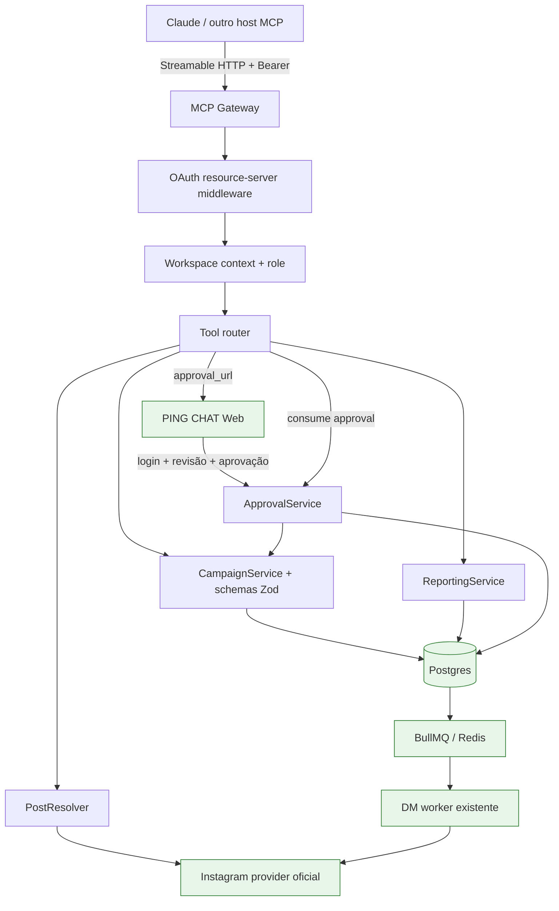
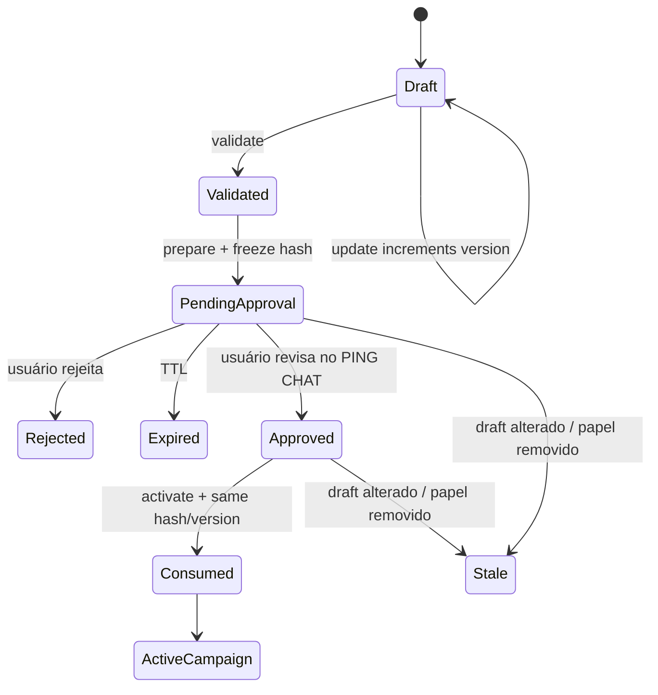

# Arquitetura MCP do PING CHAT

**Status:** proposta original para revisão; nenhum código, schema ou infraestrutura é alterado
por este documento.

## Resultado desejado

Um creator conectado ao PING CHAT poderá dizer ao Claude:

> Crie uma automação nesse Reel para entregar minha playlist a quem comentar PAGODE,
> incentivar novos seguidores e acompanhar os cliques.

O Claude lê apenas as capacidades e contas autorizadas, constrói um rascunho, recebe
validações e uma prévia, e abre uma revisão no PING CHAT. A campanha só fica ativa depois que
um usuário com papel permitido aprova exatamente aquela versão. Ativar significa processar
**eventos futuros**; não envia DM de teste nem mensagem retroativa.

## Princípios

1. **Meta oficial:** Instagram é conectado ao PING CHAT por OAuth oficial. MCP nunca recebe
   senha do Instagram e nunca faz scraping.
2. **Workspace derivado da identidade:** o tenant vem do grant OAuth e é revalidado no
   servidor. Nenhuma tool aceita um `workspace_id` arbitrário.
3. **Claude cria drafts; humanos autorizam efeitos:** criação, validação e preview não ativam
   automações. Publicação e pausa têm política e auditoria próprias.
4. **Um domínio, vários adaptadores:** UI, REST e MCP chamam o mesmo schema e
   `CampaignService`; não duplicam validação nem chamam um ao outro por HTTP interno.
5. **Dados externos são conteúdo, não instrução:** legenda, comentário, URL e nome de perfil
   são tratados como não confiáveis.
6. **Menor privilégio:** scopes, papel, conta, draft e ação são verificados em toda chamada.
7. **Sem imitar contratos proprietários:** nomes, schemas, fluxo de aprovação e modelo são do
   PING CHAT.

## Visão de componentes



Verde indica componentes existentes que serão reutilizados ou adaptados. O MCP não chama o
worker diretamente e não oferece uma tool de envio imediato.

## Transporte e compatibilidade

- Endpoint proposto: `https://mcp.pingchat.example/mcp`.
- Transporte: Streamable HTTP. HTTP+SSE legado não será a base de uma nova integração.
- Baseline de interoperabilidade inicial: revisão estável MCP `2025-11-25`, com negociação de
  versão e testes reais contra Claude. A revisão draft seguinte não deve ser assumida antes
  de suporte confirmado pelo host e SDK.
- O servidor começa stateless; IDs de draft e aprovação são handles explícitos persistidos.
  Isso evita afinidade de sessão e torna retry/failover previsíveis.
- Limites: body, tempo, concorrência e número de tool calls por usuário/workspace. `Host` e
  `Origin` são validados para reduzir DNS rebinding.

A especificação recomenda Streamable HTTP para servidores remotos e o Claude aceita uma URL
de MCP remoto em conectores customizados. Referências:
[transporte MCP](https://modelcontextprotocol.io/specification/2025-11-25/basic/transports) e
[conector do Claude](https://support.claude.com/en/articles/11175166-get-started-with-custom-connectors-using-remote-mcp).

## OAuth e isolamento por workspace

O endpoint MCP é um OAuth resource server; ele valida access tokens, mas não emite tokens. Um
authorization server dedicado — próprio ou gerenciado — atende login, consentimento,
emissão, refresh e revogação.

### Descoberta e fluxo

1. Claude chama `/mcp` sem credencial.
2. O servidor responde `401` com `WWW-Authenticate` apontando para Protected Resource
   Metadata (RFC 9728).
3. O cliente descobre o authorization server e inicia Authorization Code + PKCE `S256`.
4. O usuário entra no PING CHAT, escolhe um workspace do qual é membro e consente os scopes.
5. O authorization server emite token curto com `iss`, `sub`, `aud`, `exp`, `scope`, `jti` e
   um identificador interno do workspace autorizado.
6. O resource server valida assinatura/JWKS, issuer, audience/resource, expiração e scopes.
7. Antes de cada tool call, o backend revalida membership e papel no banco. Remover o membro
   corta o acesso mesmo antes de o token expirar.

Endpoints públicos de descoberta propostos:

- `/.well-known/oauth-protected-resource/mcp`;
- metadata RFC 8414 no authorization server;
- JWKS, authorize, token e revocation no authorization server.

Claude oferece identidade publicada, registro automático ou cliente OAuth próprio. A
implementação deve priorizar Client ID Metadata Documents quando suportado e manter fallback
compatível somente após teste. Redirect URIs são exatas; PKCE, state e consentimento são
obrigatórios. A especificação de
[autorização MCP](https://modelcontextprotocol.io/specification/2025-11-25/basic/authorization)
é a fonte normativa.

### Scopes

| Scope | Permite | Papel mínimo sugerido |
| --- | --- | --- |
| `accounts:read` | listar contas e resolver post pertencente a elas | MEMBER |
| `campaigns:read` | ler campanhas e capacidades | MEMBER |
| `drafts:write` | criar/alterar/validar drafts | ADMIN |
| `campaigns:publish` | preparar e consumir aprovação para ativar/pausar | ADMIN |
| `analytics:read` | métricas agregadas sem PII de contatos | MEMBER |

Scope nunca substitui papel. Um token com `campaigns:publish` falha se o usuário deixou de ser
ADMIN/OWNER. Tokens da Meta e credenciais de provedores não entram em claims, respostas MCP
ou logs.

## Contexto de autorização

Cada handler recebe um objeto criado pelo middleware, nunca argumentos do modelo:

```ts
type McpAuthContext = {
  userId: string;
  workspaceId: string;
  role: "OWNER" | "ADMIN" | "MEMBER";
  scopes: Set<string>;
  grantId: string;
  requestId: string;
};
```

Buscas por IDs seguem `{ id, workspaceId: auth.workspaceId }`. Contas Instagram também são
resolvidas pelo workspace antes de qualquer chamada ao provider. A primeira membership do
usuário, hoje usada em partes da aplicação, não é suficiente para MCP: o workspace deve ser
selecionado no consentimento e ficar visível na tela do conector.

## Modelo de domínio proposto

Modelos atuais (`Automation`, `TrackedLink`, `LinkClick`, `InstagramAccount`) permanecem a
fonte da campanha ativa. Uma implementação posterior pode adicionar:

### `CampaignDraft`

- `id`, `workspaceId`, `createdByUserId`, `source` (`WEB` ou `MCP`);
- `objective`: `SALES`, `PLAYLIST`, `LEADS` ou `FOLLOWERS`;
- payload normalizado compatível com o schema de campanha;
- `version` monotônica, `contentHash`, `status`, timestamps e expiração;
- warnings/capability snapshot usados no preview.

### `CampaignApproval`

- `id`, `workspaceId`, `draftId`, `draftVersion`, `contentHash`;
- `state`: `PENDING`, `APPROVED`, `CONSUMED`, `REJECTED`, `EXPIRED`;
- `requestedBy`, `approvedBy`, `expiresAt`, `approvedAt`, `consumedAt`;
- `idempotencyKey`, `automationId` e resumo de impacto.

### `McpGrant` e `AuditEvent`

- Grant: usuário, workspace, OAuth client, scopes, criação, último uso e revogação.
- Audit: actor, grant, tool, alvo, hash dos argumentos redigidos, resultado, request/idempotency
  IDs, IP resumido e timestamps.
- Nunca registrar access token, token Meta, conteúdo integral de DM ou PII de destinatários.

Os modelos são proposta; schema e migração terão PR próprio, aditivo, revisão humana e teste
em Postgres descartável.

## Contratos das tools

Todos os schemas usam versão, limites explícitos e `additionalProperties: false`. IDs são
opacos; datas são ISO 8601 UTC. Respostas mutáveis incluem `request_id` e estado final.

| Tool | Efeito | Contrato resumido |
| --- | --- | --- |
| `get_campaign_capabilities` | leitura | Retorna limites e features por conta/provider; não promete capacidade indisponível |
| `list_instagram_accounts` | leitura | Contas do workspace autorizado, estado de conexão e capabilities; nunca tokens |
| `resolve_instagram_post` | leitura externa | Recebe `account_id` + permalink; confirma mídia da conta via provider oficial |
| `list_campaigns` | leitura | Filtros limitados, paginação e resumo sem dados de contatos |
| `get_campaign` | leitura | Configuração e status de uma campanha do workspace |
| `create_campaign_draft` | grava draft | Objetivo, conta, post, gatilhos, mensagens, links e regras; sempre inativo |
| `update_campaign_draft` | grava draft | Patch com `expected_version`; alteração invalida aprovação anterior |
| `validate_campaign_draft` | leitura do draft | Erros de campo, warnings Meta/provider e conflitos com campanhas existentes |
| `preview_campaign_draft` | leitura do draft | Preview canônico, sequência de eventos, URLs/hosts e impacto; sem envio |
| `prepare_campaign_activation` | cria aprovação | Congela versão/hash e retorna `approval_url`; não ativa |
| `activate_campaign` | efeito real | Só consome aprovação humana já `APPROVED`, hash/version e idempotency key |
| `pause_campaign` | efeito real | Exige confirmação de pausa e idempotência; não apaga histórico |
| `get_campaign_performance` | leitura | Agregados de comentários, DMs, cliques, CTR e seguidores disponíveis |

Não haverá tools `send_dm`, `reply_to_comment`, `run_campaign_now` ou acesso genérico ao banco.

### Entrada principal de draft

```json
{
  "schema_version": "1",
  "objective": "PLAYLIST",
  "account_id": "acct_opaque",
  "post": { "type": "PERMALINK", "url": "https://www.instagram.com/reel/..." },
  "trigger": {
    "match": "ANY_KEYWORD",
    "keywords": ["PAGODE"],
    "whole_word": true,
    "public_replies": ["Te mandei no direct, {username}!"]
  },
  "delivery": {
    "opening": { "message": "Posso te mandar a playlist?", "button": "Quero ouvir" },
    "message": "Aqui está sua playlist, {username}.",
    "require_follow": true,
    "follow_prompt": "Siga o perfil e toque abaixo para liberar.",
    "follow_button": "Já estou seguindo"
  },
  "links": [{
    "label": "Abrir playlist",
    "destination_url": "https://example.com/playlist",
    "tracking": true
  }]
}
```

O workspace não aparece no input. A tool normaliza keyword/copy, resolve o post e grava um
draft inativo. `SALES` e `LEADS` podem criar link rastreado, mas a validação retorna warning
enquanto webhook de receita ou captação de lead não existir; não inventa métricas.

### Resposta de validação

```json
{
  "valid": true,
  "draft_id": "draft_opaque",
  "version": 3,
  "content_hash": "sha256:...",
  "errors": [],
  "warnings": [
    { "code": "FOLLOW_STATUS_MAY_BE_UNAVAILABLE", "field": "delivery.require_follow" }
  ],
  "impact": {
    "activates_for_future_events": true,
    "sends_immediately": false,
    "matched_existing_campaigns": 0
  }
}
```

## Resolução do post e links

`resolve_instagram_post` aceita somente permalink HTTPS de hosts oficiais do Instagram,
normaliza o shortcode e procura a mídia por APIs autorizadas da conta selecionada. Se não
conseguir provar ownership, retorna `POST_NOT_OWNED`; não baixa HTML público nem tenta login.

Links de destino:

- HTTPS por padrão; sem credenciais embutidas, IP privado/loopback, esquema executável ou
  redirect ilimitado;
- hostname Unicode convertido/mostrado com segurança para evitar homógrafos;
- host final aparece no preview e na aprovação;
- parâmetros UTM são normalizados de forma determinística e não sobrescrevem valores sem
  consentimento;
- o redirect existente do PING CHAT continua registrando clique sem revelar o destinatário.

## Validação compartilhada

Extrair de `app/api/automations/route.ts`, `components/campaign-validation.ts` e
`components/campaign-builder.tsx`:

```text
lib/campaigns/schema.ts       schema e normalização
lib/campaigns/capabilities.ts limites Meta/provider
lib/campaigns/service.ts      create/update/activate workspace-scoped
lib/campaigns/preview.ts      preview canônico e hash
lib/campaigns/conflicts.ts    colisões de post/keyword
```

REST, UI e MCP usam essas funções. O React `CampaignBuilder` continua sendo a interface, não
uma dependência do servidor. Para MCP, `create` sempre começa inativo, mesmo que a rota REST
legada aceite `isActive`; ativação é uma operação separada.

Validações mínimas:

- membership, role, account e post pertencentes ao workspace;
- limites atuais de keywords, variações, mensagens, botões e follow-up;
- pelo menos um caminho de entrega coerente e placeholders permitidos;
- URLs e tracking válidos;
- conflito com campanha ativa que consumiria a única resposta privada do comentário;
- capability do provider e permissões/webhook atuais;
- política Meta revalidada na documentação oficial antes da implementação.

## Aprovação com efeito real



`prepare_campaign_activation` devolve URL de primeira parte, resumo e TTL; não devolve um
segredo que, sozinho, permita ativar. Na página, o usuário autenticado vê conta, post,
keywords, sequência de DMs, links/hosts, follow gate, warnings e efeito futuro. A aprovação
grava `approvedBy` e o hash exato.

`activate_campaign` exige approval `APPROVED`, versão/hash idênticos, papel ainda válido e
`idempotency_key`. Uma repetição com a mesma chave devolve a mesma campanha; mesma chave com
payload diferente falha. A operação cria/atualiza `Automation` e `TrackedLink` numa transação,
marca approval `CONSUMED` e registra audit event. Qualquer alteração invalida a aprovação.

## Erros estáveis

As tools retornam erro estruturado, sem stack trace ou mensagem bruta do provider:

- `AUTH_REQUIRED`, `INSUFFICIENT_SCOPE`, `ROLE_REQUIRED`;
- `WORKSPACE_ACCESS_REVOKED`, `ACCOUNT_NOT_FOUND`, `POST_NOT_OWNED`;
- `VALIDATION_FAILED`, `CAPABILITY_NOT_AVAILABLE`;
- `DRAFT_VERSION_CONFLICT`, `APPROVAL_REQUIRED`, `APPROVAL_STALE`, `APPROVAL_EXPIRED`;
- `IDEMPOTENCY_CONFLICT`, `RATE_LIMITED`, `PROVIDER_TEMPORARY_FAILURE`.

Cada erro informa `retryable`, `request_id` e, quando seguro, `field_errors`. Erro do provider
fica redigido no log interno.

## Modelo de segurança

| Risco | Controle obrigatório |
| --- | --- |
| Prompt injection em legenda/comentário | Dados externos em campos delimitados; tool descriptions proíbem tratá-los como instruções; nenhum auto-approve |
| IDOR/cross-tenant | Workspace do token + query composta `{ id, workspaceId }` em toda entidade |
| Confused deputy | Scope + papel + consentimento + rechecagem no momento da ação |
| OAuth CSRF/mix-up/token substitution | PKCE S256, state, redirect exato, issuer/audience/resource e JWKS validados |
| Replay/duplicação | Approval single-use, draft hash/version e idempotency key persistida |
| SSRF/open redirect | Parser/allowlist, DNS/IP privado bloqueado, redirects limitados e host mostrado |
| Ativação em massa | Uma aprovação por draft/campanha, quotas, rate limit e alerta por workspace |
| Exfiltração por logs | Redaction, sem tokens/PII/conteúdo integral, retenção e acesso restritos |
| Race de papel ou draft | Checagem e consumo transacionais; lock/version otimista |
| Abuso do schema MCP | JSON Schema fechado, tamanhos/enum, timeout e resposta limitada |
| DNS rebinding | HTTPS, validação Host/Origin e proxy confiável configurado |
| Webhook falso | Verificações Meta/Zernio existentes permanecem invioladas |
| Limites Meta | Worker existente, dedupe, janela, rate limiting e capability checks |

## Privacidade e observabilidade

- LGPD: finalidade e retenção documentadas para grants, approvals, audit e analytics.
- Revogar o conector impede novas calls e não desconecta Instagram automaticamente.
- Exclusão do workspace remove/revoga grants e drafts conforme política; audit mínimo pode ser
  retido por obrigação de segurança, de forma pseudonimizada.
- Métricas: latência/erro por tool, auth failures, validation failures, approval conversion,
  ativações idempotentes, rate limits e provider errors; sem conteúdo de DM como label.
- OpenTelemetry usa request/trace IDs redigidos; alertas para cross-tenant denial, replay,
  volume anômalo e falhas de revogação.

## Compatibilidade com a Meta

O PING CHAT continua limitado às capacidades oficiais disponíveis à conta profissional e ao
provider escolhido. Uma campanha ativa não garante entrega: permissão, ownership do post,
janela de mensagens, única private reply por comentário, rate limit e disponibilidade do
follow status continuam valendo. O MCP nunca contorna esses limites e deve exibir warnings
antes da aprovação. A
[coleção oficial da Meta para Instagram](https://www.postman.com/meta/instagram/documentation/6yqw8pt/instagram-api)
é uma das referências de implementação e confirma o escopo para contas profissionais,
permissões de mensagens/comentários e ownership da mídia; a documentação oficial vigente
deve ser revalidada no início de cada PR de integração.

## Decisões que exigem revisão humana

- authorization server/IdP e domínio final;
- scopes e papéis mínimos, especialmente `campaigns:publish`;
- retenção de audit/grants e base legal LGPD;
- modelo de atribuição de vendas/leads;
- política de conflito entre automações;
- suporte a aprovação dentro do host MCP versus somente no PING CHAT Web;
- requisitos atuais da Meta App Review antes do beta.
