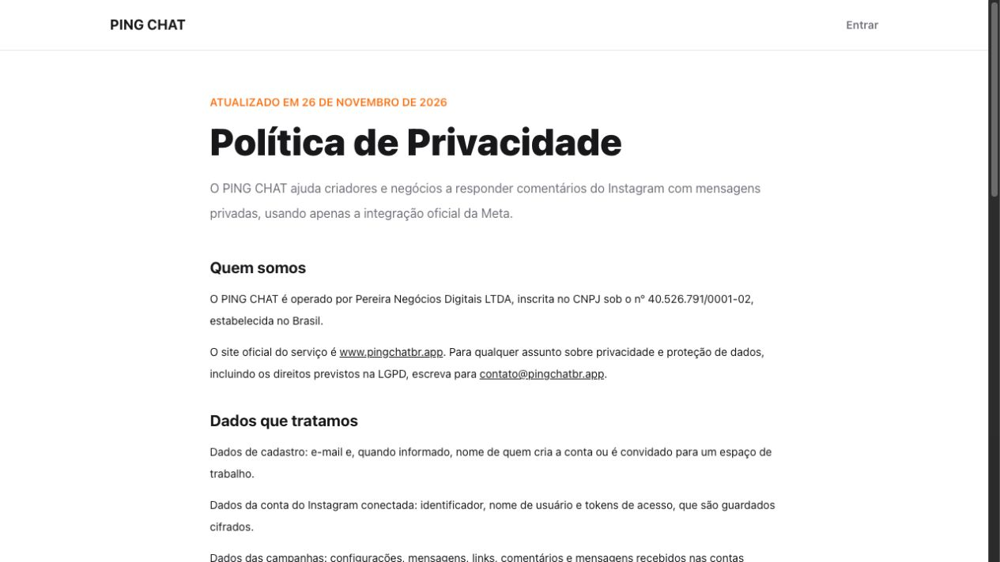
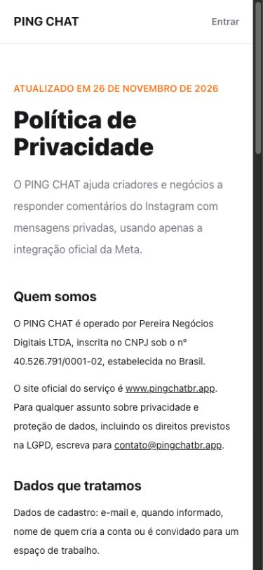

# Identificação pública na política de privacidade

A versão de 26/11/2026 de `/privacy` identifica a operadora do PING CHAT como
**Pereira Negócios Digitais LTDA**, CNPJ **40.526.791/0001-02**, estabelecida no
Brasil. A razão social, o CNPJ e o país foram confirmados pelo responsável do
produto em 26/11/2026. Nenhum endereço físico ou contato pessoal foi presumido.

O endereço canônico é `https://www.pingchatbr.app/privacy`; o contato de privacidade
continua sendo `contato@pingchatbr.app`. A página permanece pública e estática em
português, no formato das páginas legais existentes. Não há nova mensagem de
interface localizada: os dados cadastrais são identificadores da empresa.

Esta correção de identificação não muda as finalidades, os fornecedores, os
prazos, os direitos descritos nem a distinção existente entre dados dos clientes
do serviço e dados de contatos tratados em nome de cada cliente. Também não
declara que novos procedimentos de atendimento a autoridades foram implantados.

## Revisão e publicação

- Revisão Claude e aprovação humana antes do merge, conforme `AGENTS.md`.
- Após o deploy aprovado, conferir a identificação no HTML público de `/privacy`,
  o link canônico, o contato e o link de exclusão de dados em desktop e mobile.
- O cadastro do app Meta deve usar o mesmo endereço canônico. Preparar um
  rascunho de Acesso Avançado não autoriza enviar a solicitação à Meta.
- A revisão dos países de processamento dos fornecedores e as evidências de
  funcionamento exigidas pela Meta são etapas separadas; esta alteração não
  afirma que essas pendências foram concluídas.

Rollback: reverter este commit ou restaurar o deploy web anterior. Não há schema,
migração, variável de ambiente ou mudança no worker a desfazer.

## Evidencias visuais do build local

