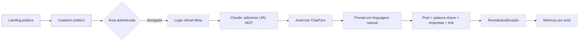
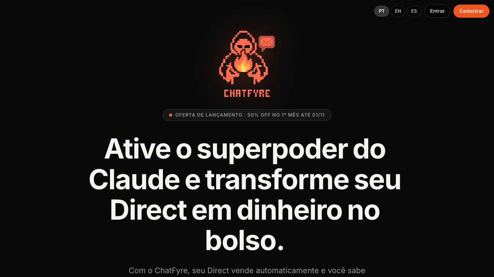
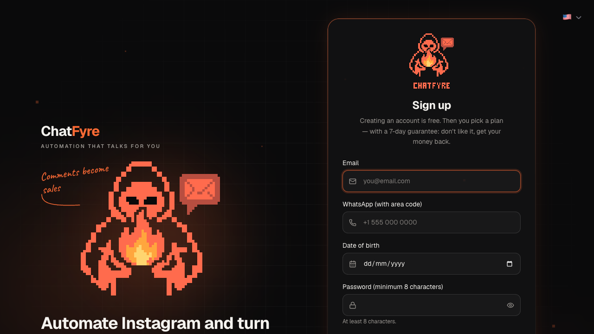
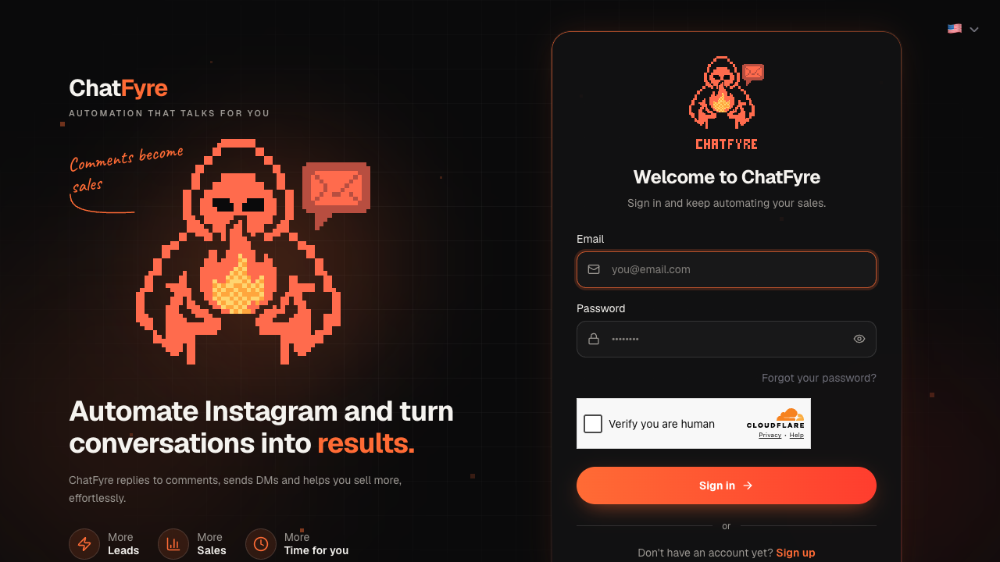

# Pesquisa pública: ChatFyre com REA

**Data da coleta:** 29 de outubro de 2026
**Escopo:** superfícies públicas do ChatFyre e código público do PING CHAT
**Método:** REA 6.8.0, Playwright, inspeção de HTML/JavaScript público e leitura do repositório
**Regra de evidência:** observação externa não é evidência da arquitetura interna do concorrente.

## Resumo executivo

O ChatFyre comunica uma jornada curta: conectar o Instagram pela Meta, adicionar
`https://mcp.chatfyre.com/mcp` como conector do Claude, descrever uma campanha e deixar o
Claude configurar post, palavra-chave, resposta pública, DM, botão, link e publicação. A
landing page também divulga bloqueio por follow, variação A/B da primeira linha, webhooks de
venda e métricas por vídeo.

Foi possível verificar a landing, cadastro, login, recursos estáticos e as instruções públicas
de conexão. Não foram fornecidas credenciais legítimas; portanto, painel autenticado,
pagamento, nomes reais das ferramentas MCP, erros de ativação e acompanhamento interno não
foram executados. Os itens dessa parte aparecem como **divulgados**, não como **verificados**.

O PING CHAT já tem a maior parte do motor necessário: contas e workspaces, seleção de post,
palavras-chave, resposta pública, DM com até dois links rastreados, abertura por botão,
follow gate, follow-up, prévia, ativação, fila, deduplicação e relatórios de clique. O maior
gap não é o envio de DM; é a camada MCP segura: OAuth, contratos estáveis, rascunho persistido,
aprovação de efeito real, auditoria e isolamento de workspace no novo canal.

## Limites éticos e operacionais

- Apenas páginas e ativos públicos foram acessados. Nenhuma autenticação, assinatura,
  CAPTCHA/Turnstile ou controle de acesso foi contornado.
- Nenhuma senha, token, segredo, código privado ou dado de terceiro foi coletado.
- Nenhum formulário foi submetido e nenhuma DM, campanha ou migração foi executada.
- O JavaScript público foi usado apenas para confirmar textos, rotas e URLs já entregues ao
  navegador. Ele não revelou contratos MCP nem justifica inferir a implementação do backend.
- A indisponibilidade de DNS de `mcp.chatfyre.com` no terminal desta coleta é uma limitação do
  ambiente, não evidência de indisponibilidade do serviço.

## Legenda de confiança

| Marca | Significado |
| --- | --- |
| **O** | Observado diretamente na página, rede pública ou repositório público |
| **D** | Divulgado publicamente pelo produto, mas não executado nesta coleta |
| **H** | Hipótese; precisa de validação e não descreve a arquitetura interna |
| **N** | Não observado por falta de autorização ou superfície pública |

## Jornada observada e divulgada

| Etapa | Estado | Evidência e limite |
| --- | --- | --- |
| Descoberta | **O** | Landing em pt-BR com CTA para `/cadastro` e proposta de criar automações com Claude |
| Cadastro | **O** | E-mail, WhatsApp, nascimento, senha de pelo menos 8 caracteres, aceite obrigatório e opt-in de marketing opcional; Turnstile presente |
| Login/recuperação | **O** | E-mail, senha, mostrar senha, recuperação e link de cadastro; sem tentativa de login |
| Conectar Instagram | **D** | Instrução pública para usar login oficial da Meta; fluxo autenticado não executado |
| Conectar Claude | **O/D** | Instrução pública: Claude > Connectors > custom connector > URL MCP > autorização com login do ChatFyre; autorização não executada |
| Pedir campanha | **D** | Exemplo público pede post recente, palavra `QUERO`, resposta pública, DM de boas-vindas, botão, link com UTM e publicação |
| Ler post | **D** | Demonstração textual mostra “Post lido”; request autenticado não observado |
| Montar automação | **D** | Post, gatilho, mensagem, botão e tracking aparecem na demonstração pública |
| Revisar/publicar | **D** | A demonstração termina em publicação; tela e mecanismo de confirmação não observados |
| Acompanhar | **D** | Mock público exibe contatos, cliques, vendas e receita por post; dados reais não observados |
| Editar/pausar | **N** | Nenhum fluxo público suficiente para documentar comportamento |

### Fluxo visual consolidado



As caixas tracejadas foram descritas publicamente, mas não percorridas em uma sessão
autenticada nesta pesquisa.

## Inventário funcional da referência

| Capacidade | Evidência | Observação |
| --- | --- | --- |
| Reel, Story e carrossel | **D** | Afirmação de marketing |
| Post específico ou escopo global | **D** | Afirmação de marketing |
| Gatilho por palavra-chave | **D** | Exemplo público usa `QUERO` |
| Resposta pública | **D** | Incluída no prompt de exemplo |
| DM com botão e link | **D** | Incluída na demonstração |
| Link com `utm_content` | **D** | A landing descreve tracking por vídeo |
| Condição de seguidor | **D** | “Follower gate” divulgado; regra exata desconhecida |
| A/B da primeira linha | **D** | Divulgado; amostragem, atribuição e significância desconhecidas |
| Webhooks Cakto/Kiwify/Hotmart | **D** | Divulgados para atribuição de vendas |
| Contatos, cliques, vendas e receita | **D** | Painel ilustrativo público |
| Escala por plano | **O** | Página pública apresenta limites de vídeos e contatos |
| Disparo frio em massa | **O** | A comunicação pública declara que não o realiza |
| Ferramentas MCP específicas | **N** | Não há catálogo público ou nomes confirmados |

“Ferramenta MCP divulgada” neste relatório significa a **capacidade demonstrada**. Não foram
inventados nomes, schemas ou quantidade de tools do ChatFyre.

## Telas, validações e comunicações públicas

### Landing



- Título observado: `ChatFyre | Automação de DM do Instagram`.
- A página apresenta o endpoint MCP, o exemplo de prompt, planos e a demonstração da jornada.
- Requests públicas observadas: documento HTML, Google Fonts, um bundle JavaScript e um CSS.

### Cadastro



- A tela abriu em inglês, embora a landing estivesse em pt-BR.
- Foram observados required fields e mínimo de oito caracteres na senha.
- O Turnstile foi carregado. Não houve envio nem tentativa de resolver o desafio.
- Avisos do challenge no console não foram classificados como bug do produto.

### Login



- A tela abriu em inglês e contém recuperação de senha.
- Credenciais não foram preenchidas.

### Manifesto das evidências

| Arquivo | Página pública | Captura UTC | SHA-256 | Dimensão |
| --- | --- | --- | --- | --- |
| `landing.png` | `https://chatfyre.com/` | 2026-10-29 19:02:46 | `4babf4888a41b9fe0d7d51842c82efb386c44df6c2c30ff37171ed6485d1995f` | 1280×720 |
| `cadastro.png` | `https://chatfyre.com/cadastro` | 2026-10-29 19:03:04 | `a817da2fd1216eb42a5d05052e3f6b94055be0b998b48b17d4780ca5c4845c80` | 1280×720 |
| `entrar.png` | `https://chatfyre.com/entrar` | 2026-10-29 19:15:49 | `fa18c73b4be388a9de7f40214ed84475418773bea0cee972b558109b9b693a9b` | 1280×720 |

O bundle público `assets/index-B94oFodp.js` tinha 560.435 bytes e SHA-256
`802d62e905b18a073fb5c0d61f11641ceae42f81da5fab80c5baf0fa7e8a1e1a`. A busca textual
confirmou rotas, textos, endpoint MCP, páginas legais e telemetria de evento, mas não expôs
nomes de tools nem arquitetura do servidor.

## Auditoria do REA

O [REA — Reverse Engineer Anything](https://github.com/morluto/rea) foi clonado em diretório
temporário e estudado no commit `1da304b28213ca7a50f6787eae716abe73c4e628` (pacote 6.8.0).

### Requisitos, licença e dependências

- Node aceito: `^22.23.4 || ^24.22.1 || >=26.12.1`; o runtime isolado usado foi 24.22.1.
- npm esperado: 11.16.0; uma cópia foi instalada apenas em `/tmp/pingchat-node-tools`.
- O código do REA é MIT. Licenças de terceiros permanecem aplicáveis, e Hopper/IDA/JEB
  exigem licenças próprias quando usados.
- O pacote não declara `preinstall`, `install` ou `postinstall`. `prepare` e `prepack` são
  scripts de desenvolvimento/publicação; a execução foi feita com scripts npm desabilitados.
- `npm audit --omit=dev --package-lock-only --ignore-scripts` não reportou vulnerabilidades
  conhecidas nas dependências de produção naquele lock. Isso não elimina risco de supply
  chain nem o poder operacional de Playwright, PTY, Frida ou adaptadores nativos.

### Revisão do instalador

O setup documenta preview das mudanças, aprovação, backup `.rea.backup`, staging privado e
checagem de conflitos. Hopper é opcional e tem confirmação separada. Foi executado apenas:

```bash
npm_config_ignore_scripts=true npx --yes --package=rea-agents@6.8.0 \
  rea-agents setup --client codex --dry-run --json
```

O dry-run propôs:

- alterar `~/.codex/config.toml` e criar `config.toml.rea.backup`;
- registrar `npx -y rea-agents@6.8.0 mcp`;
- instalar a skill `reverse-engineer-anything` em `~/.agents/skills`;
- seguir sem Ghidra, IDA, JADX ou Kuna, que não estavam configurados.

**Decisão:** o setup não foi aplicado. O PATH normal do Codex não tinha `npx`; registrar esse
comando global produziria uma configuração quebrada. Nenhuma configuração do Codex, Claude
ou MCP foi alterada. Para retomar com segurança: instalar Node/npm em PATH persistente,
repetir o dry-run, revisar o diff e só então executar o setup interativo.

### Resultado do uso

`capture-browser-scenario` capturou a landing sem clique nem submissão:

- evidence id `ev_b03f6a35265c165d5181d98ea99c4a8f67a886443122560a73be47c3153ae174`;
- SHA-256 do cenário `80c28c715a56a1476235f05124bfa23725a5d7d1731c7dbe5dc21425d480f54d`;
- 22 eventos retidos, zero descartados, completude marcada como completa;
- browser iniciado e encerrado pelo provider do REA.

A análise estática do bundle chegou às fases de parse/análise, mas excedeu a janela de
execução mesmo com limites de nós, memória e unknowns. Portanto, não há evidência estática a
publicar — isso é inconclusivo, não “ausência de achados”. A documentação e o binário 6.8.0
também divergiram: `--detail` era descrito para captura, mas foi rejeitado por esse comando.

## Skills avaliadas

O Find Skills localizou Playwright oficial, `reverse-engineering-api`, `web-to-prd`,
`browser-automation`, `js-reverse` e uma skill WebMCP. Foi mantida a skill oficial de
[Playwright](https://www.skills.sh/openai/skills/playwright), já instalada. Skills redundantes
ou com sinais de segurança fracos não foram instaladas; a WebMCP encontrada era voltada a
tools no browser, não a um resource server MCP remoto. Os contratos do PING CHAT serão
baseados na especificação oficial, não em uma skill de terceiro.

## Análise competitiva e comparação com o PING CHAT

A força observável da referência é reduzir uma configuração multietapa a uma conversa e
mostrar resultado por post. Não há evidência pública de que isso dependa de uma arquitetura
inimitável; a vantagem visível está na orquestração, onboarding e apresentação das
capabilities.

O PING CHAT pode se diferenciar sem copiar a implementação: motor auditável e self-hosted,
workspace/roles explícitos, preview canônico, aprovação humana vinculada ao hash, capability
checks honestos por provider e nenhum tool de envio arbitrário. O caminho mais curto não é
refazer o worker, mas expor com segurança o domínio que já existe.

Lacunas competitivas reais são conexão do Claude, permalink resolver, atribuição de
vendas/leads e A/B mensurável. Promessas de paridade nessas áreas devem esperar modelos,
contratos e evidência operacional próprios.

| Domínio | Já existe | Gap para a experiência pretendida |
| --- | --- | --- |
| Identidade e tenant | Auth.js, `Workspace`, membros e papéis | Seleção explícita de workspace no consentimento MCP e tokens com audience/scope |
| Instagram | OAuth oficial Meta, token cifrado, múltiplas contas | Resolver permalink para mídia autorizada sem scraping |
| Campanha | `Automation`, keywords, post específico/qualquer/próximo, DM e ativação | Schema/serviço compartilhado e estado de draft/version |
| Mensagens | Resposta pública, opening DM, mensagem principal, dois botões, follow gate e follow-up | Contrato MCP e política de copy por objetivo |
| Segurança de envio | Fila, dedupe por comentário, idempotência de resposta pública e rate limit | Aprovação imutável antes de ativar pelo MCP |
| Tracking | `TrackedLink`, `LinkClick`, CTR e histórico de seguidores | UTM normalizada, leads/vendas e atribuição de receita |
| Interface | `CampaignBuilder`, wizard, revisão e preview | Preview persistente compartilhado com Claude |
| Analytics | Campanhas, cliques, top keywords e relatórios | Tool read-only agregada e métricas de objetivo |
| A/B | Variações aleatórias de resposta pública | Experimento explícito da primeira linha, coorte e resultado |
| MCP | Nenhum endpoint/modelo dedicado | Transporte, OAuth, tools, auditoria, scopes e observabilidade |

Arquivos-base: `prisma/schema.prisma`, `app/api/automations/route.ts`,
`app/api/instagram/posts/route.ts`, `components/campaign-builder.tsx`,
`lib/meta/oauth.ts`, `lib/workspace-access.ts`, `lib/queue/dm-worker.ts` e
`app/r/[slug]/route.ts`.

### O que já conseguimos reproduzir legitimamente

- conexão oficial Meta/Zernio, conta por workspace e tokens cifrados;
- post específico, qualquer post ou próximo post;
- até dez keywords, qualquer palavra e match whole/partial;
- resposta pública com variações, abertura por botão, DM e links rastreados;
- follow gate com rechecagem, follow-up e gatilho opcional por DM;
- preview, revisão, ativação futura, logs, CTR e relatórios;
- deduplicação da única resposta privada por comentário e fila com rate limiting.

### Implementação adicional necessária

- resource server MCP remoto e OAuth compatível com Claude;
- seleção/consentimento de workspace, revogação e scopes;
- `CampaignService` e schemas compartilhados entre UI/API/MCP;
- permalink resolver restrito a contas autorizadas;
- draft persistido, versão/hash, validação e preview canônico;
- aprovação humana de dois passos, idempotency key e audit log;
- tools de leitura, construção, validação, ativação/pausa e performance;
- proteção contra prompt injection, SSRF, IDOR, replay e abuso de volume;
- leads/vendas e atribuição de receita, caso entrem no escopo do produto.

## Fatos, hipóteses e questões abertas

| Item | Classificação | Próxima validação legítima |
| --- | --- | --- |
| URL `https://mcp.chatfyre.com/mcp` | **O** | Nenhuma necessária para comparação pública |
| Claude cria e publica campanha | **D** | Sessão autorizada fornecida pelo proprietário da conta |
| OAuth usado no conector | **D** | Percorrer consentimento com conta própria |
| Nomes e schemas das tools | **N** | Não inferir; observar `tools/list` somente após autorização |
| Banco, filas e provedores internos | **H** | Fora do escopo; não necessários para o design próprio |
| Algoritmo de A/B e atribuição | **H** | Documentação oficial ou teste com dados próprios |
| Erros autenticados e edição | **N** | Roteiro de QA em conta de teste legítima |

## Fontes públicas

- [ChatFyre](https://chatfyre.com/)
- [Exclusão de dados do ChatFyre](https://chatfyre.com/exclusao-de-dados)
- [REA no GitHub](https://github.com/morluto/rea)
- [Instalação do REA](https://github.com/morluto/rea/blob/main/docs/installation.md)
- [Claude: conectores customizados com MCP remoto](https://support.claude.com/en/articles/11175166-get-started-with-custom-connectors-using-remote-mcp)
- [MCP: Streamable HTTP](https://modelcontextprotocol.io/specification/2025-11-25/basic/transports)
- [MCP: autorização](https://modelcontextprotocol.io/specification/2025-11-25/basic/authorization)
