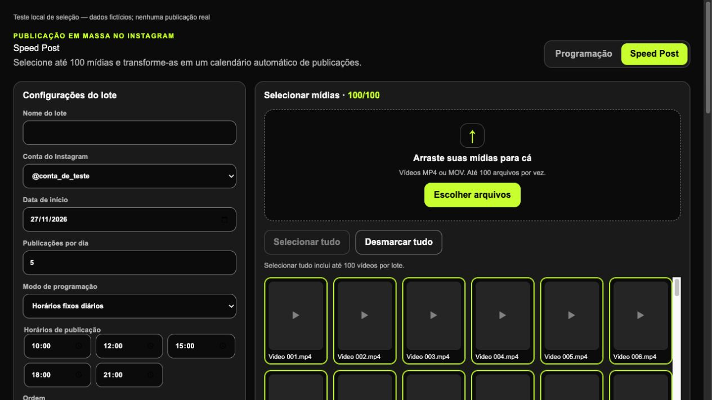
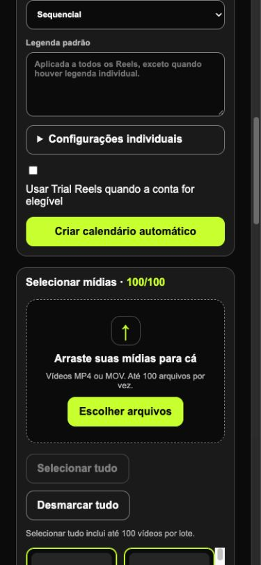

# Seleção em lote no Speed Post

Na biblioteca de vídeos já enviados, **Selecionar tudo** completa a seleção até
100 vídeos e **Desmarcar tudo** limpa a seleção. Marcar ou desmarcar não cria,
cancela ou altera publicações ou lotes existentes.

- A seleção parcial mantém sua ordem e recebe os demais vídeos sem duplicação.
- Bibliotecas com mais de 100 vídeos mostram o limite junto aos controles.
- Somente vídeos retornados pela biblioteca de mídias disponíveis são incluídos.
- Legendas individuais, datas e configurações continuam guardadas ao desmarcar e
  selecionar novamente. O calendário de prévia acompanha a seleção atual.
- Os controles de seleção ficam indisponíveis durante o envio de um lote. A ação
  de selecionar tudo também aguarda o carregamento da biblioteca.
- Programação de uma publicação individual e o backend permanecem com seus
  contratos existentes; seleção de lote não é publicação imediata.

## Validação

Três testes cobrem lote completo, limite com seleção manual e idempotência.
Conferência no navegador com o componente real e dados fictícios isolados:
100 de 100; zero após limpar; 100 de 120; imagens excluídas; legendas preservadas;
limite no clique individual; estados vazio, carregando e envio simulado; mobile
390×844 sem transbordamento horizontal. A fixture não tem credenciais e não
publica conteúdo. Essas provas de interface não comprovam uma publicação Meta.

Revisão Claude e aprovação humana antes do merge. Rollback: reverter o PR ou
restaurar a versão web anterior; sem migração, env ou deploy de worker.
